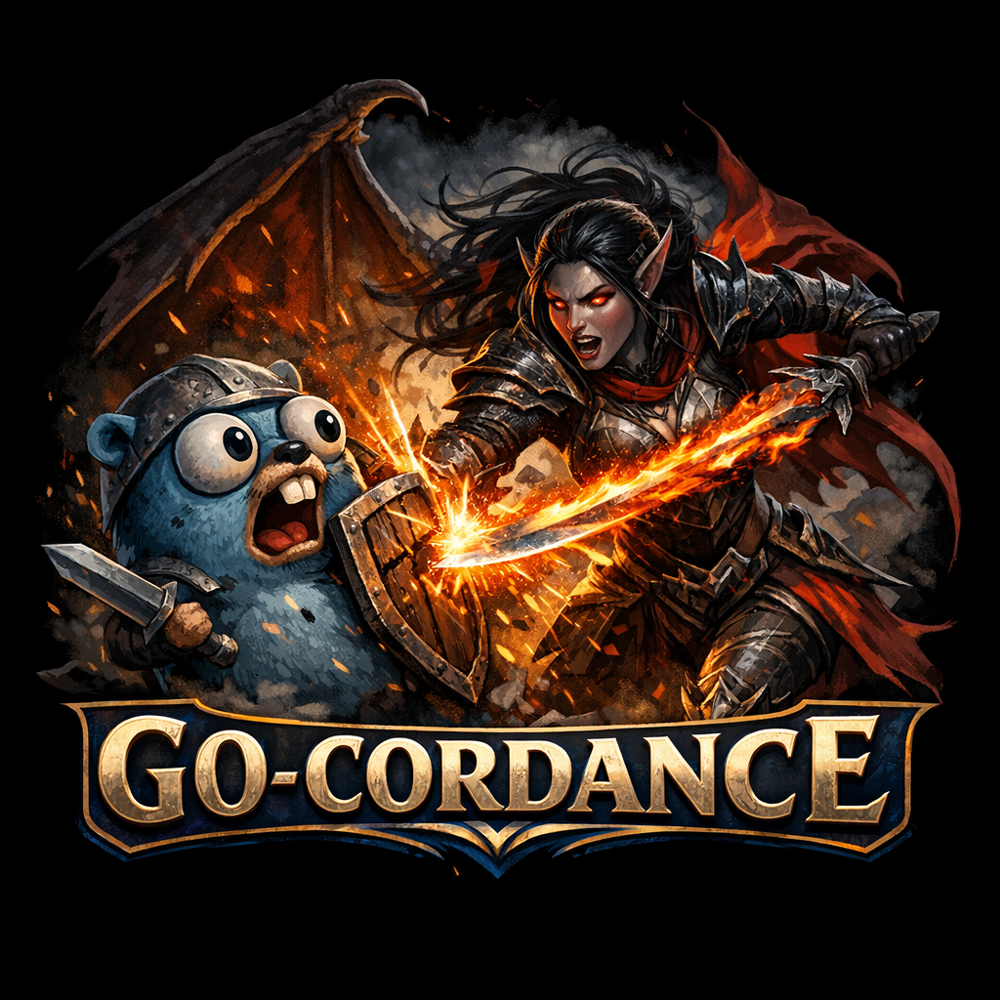

<p align="center">
  
</p>

<h1 align="center">Go-Cordance</h1>

<p align="center">
  An experimental 3D game engine and live-linked editor, written in Go.
</p>

<p align="center">
  
  
  
  
</p>

---

Go-Cordance is a hobby engine for learning how real-time 3D engines are put together. The engine uses an entity-component-system (ECS) design and renders with OpenGL. The editor is a separate program that connects to the running game over TCP, so changes made in the editor show up in the game immediately.

It is a work in progress. Expect rough edges, debug output and APIs that change.

## Contents

- [Quick start](#quick-start)
- [What's in it](#whats-in-it)
- [Controls](#controls)
- [Project layout](#project-layout)
- [Roadmap](#roadmap)
- [License](#license)

## Quick start

**Requirements**

- Go 1.25+
- A C compiler for cgo (used by `go-gl`, GLFW and Fyne)
  - Windows: MinGW-w64, e.g. via MSYS2. `setenv.bat` shows the environment variables used here.
  - Linux: `gcc` plus the usual OpenGL/X11 development packages
- A GPU with OpenGL 4.2 support

**Run**

Run both commands from the repository root, because asset paths are relative to it:

```sh
# 1. start the engine
go run ./cmd/game

# 2. in a second terminal, start the editor (connects to localhost:7777)
go run ./cmd/editor
```

**Build**

`build_windows.bat` and the `build_linux_*.sh` / `build_darwin_arm64.sh` scripts produce release binaries for the engine and the editor.

## What's in it

### Engine core
- ECS with systems for physics, transforms, animation, skinning, camera, rendering and debug drawing
- Parent/child hierarchies with transform propagation
- Scenes and prefabs saved as JSON

### Rendering
- OpenGL pipeline with JSON-described shaders and `#define` injection
- Shaders are reloaded automatically when their files change
- Materials (`.mat` files): PBR, toon, flat colour and several debug shaders
- Directional, point and spot lights with shadow mapping
- Debug views for normals, tangents, bitangents, UVs and light directions

### glTF and animation
- `.gltf` / `.glb` loading, including multi-mesh models with per-mesh materials and textures
- Skeletal animation with GPU skinning (up to 128 joints)
- Animation channels with linear, step and cubic-spline interpolation
- Basic humanoid bone mapping for retargeting clips between rigs (early)

### Physics
- Velocity, acceleration and angular motion with mass and damping
- Sphere, AABB and plane colliders
- Force system (e.g. gravity) and collision detection

### Editor
- Built with [Fyne](https://fyne.io), runs as a separate process
- Hierarchy panel and inspector; any component implementing `EditorFields()` can be edited
- Asset browser with texture, mesh and material thumbnails
- Move / rotate / scale gizmo with local/world and pivot/center modes, plus snapping
- Undo / redo kept in sync between editor and game

## Controls

These keys are handled by the engine window.

**Camera**

| Key | Action |
| --- | --- |
| `W` `A` `S` `D` | Move (camera mode) |
| Mouse | Look (camera mode) |
| `Tab` | Switch between camera mode and cursor/editor mode |
| `Esc` | Quit |

**Gizmo** (cursor mode)

| Key | Action |
| --- | --- |
| `W` / `E` / `R` / `Q` | Move / Rotate / Scale / Combined |
| `L` | Toggle local rotation |
| `P` | Toggle pivot / center |
| hold `Ctrl` | Snap while dragging |
| `Z` / `Y` | Undo / Redo |

**Rendering and debug**

| Key | Action |
| --- | --- |
| `F1` | Toggle debug rendering |
| `F2` | Toggle light debug |
| `1` – `7` | Final / normal map / tangent / bitangent / normal / tangent W / UV |
| `G` | Flip normal map green channel |
| Arrow keys | Adjust directional light |
| `Space` | Toggle orbiting light |

## Project layout

```
cmd/
  game/          engine executable (and asset/shader loaders)
  editor/        editor executable
internal/
  assets/        asset registry, texture/mesh/material import
  ecs/           entities, components and systems
  ecs/gizmo/     transform gizmo
  editor/        editor UI, state and undo
  editorlink/    TCP protocol between editor and game
  engine/        OpenGL renderer, shaders, glTF parsing, mesh manager
  scene/         scenes, prefabs, serialization, glTF spawning
  shaderlang/    shader descriptions and define injection
  thumbnails/    thumbnail generation for the editor
assets/          models, textures, materials, shaders
```

## Roadmap

Rough plans, in no particular order:

- **Rendering**: cascaded shadow maps, HDR and bloom, GPU instancing, skinned shadows
- **Animation**: blending between clips, morph targets, better retargeting
- **Editor**: component creation UI, material editor, reparenting in the hierarchy
- **Engine**: audio

## License

[Apache License 2.0](LICENSE)
